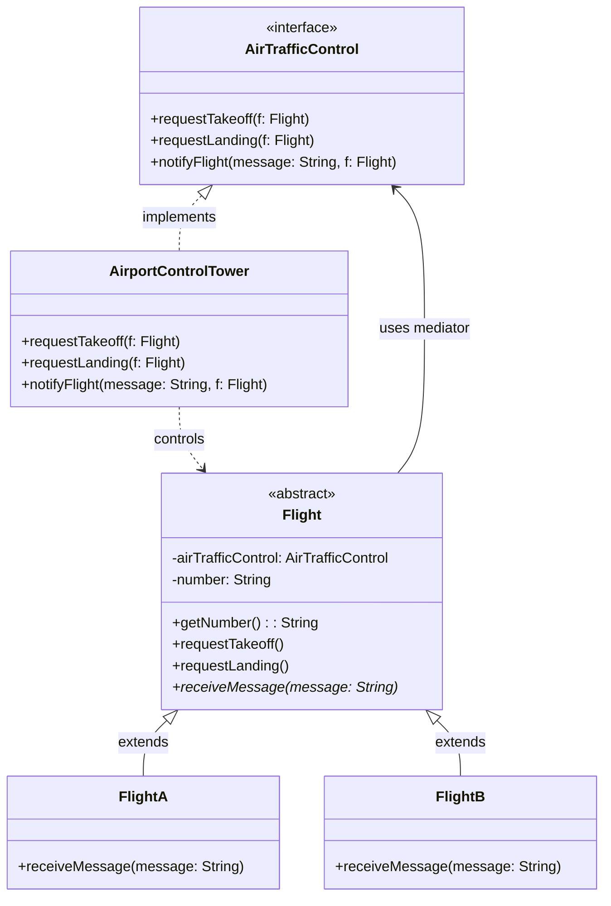

# Practical 08: Mediator Design Pattern (Airport System)

This project implements the **Mediator Design Pattern** in Java based on the **OODP2-8** practical specification under the `lk.jiat.jms` package.

---

## 📌 Problem Overview

In a busy airport, multiple airplanes (`FlightA`, `FlightB`) must coordinate takeoffs and landings. 
- **Without Mediator**: Each flight would have to communicate directly with all other flights, creating an $O(N^2)$ web of tight coupling and severe collision risk.
- **With Mediator Pattern**: Flights never communicate with each other directly. Instead, all flights communicate solely through the central **`AirportControlTower`** (`AirTrafficControl` mediator interface). The tower centralizes permissions, approval logic, and instructions.

---

## 🏛️ Class Diagram & Architecture



### Components

| Component | Role | Description |
| :--- | :--- | :--- |
| `AirTrafficControl` | **Mediator Interface** | Defines contract for requests (`requestTakeoff`, `requestLanding`) and transmissions (`notifyFlight`). |
| `AirportControlTower` | **Concrete Mediator** | Centralizes decision-making and handles communication with flights. |
| `Flight` | **Colleague (Abstract)** | Holds reference to the `AirTrafficControl` mediator and its flight number. |
| `FlightA` / `FlightB` | **Concrete Colleagues** | Specific flight implementations handling received instructions (`receiveMessage`). |
| `Main` | **Client Runner** | Instantiates the tower and flights, demonstrating landing and takeoff coordination. |
| `AirportUI` | **GUI View** | Java Swing interactive desktop interface for visual simulation. |

---

## 🛠️ Code Corrections & Refinements

The provided starter code had minor typos that were resolved:

1. **Method Signatures in `AirportControlTower`**:
   - `requestTakeoff(Flight f)` and `requestLanding(Flight f)` now match the `AirTrafficControl` interface parameter list.
2. **Identifier Casing**:
   - Normalized `notifyflight` to standard Java camelCase `notifyFlight(String message, Flight f)`.
3. **Parameter Streamlining in `Flight`**:
   - In `Flight`, `requestTakeoff()` and `requestLanding()` take no extra arguments because the flight instance passes `this` to the tower directly.

---

## 🚀 How to Run

### Using Maven:
```bash
mvn clean compile exec:java
```

### Expected Output:
```text
==================================================
  OODP2-8: Airport Mediator System Demonstration   
==================================================
Flight: 123 request permission to landing
Flight A:123 New message: Landing approved
Flight: 456 request permission to landing
Flight B:456 New message: Landing approved
Flight: 789 request permission to take off
Flight B:789 New message: Take-off approved
==================================================
```
