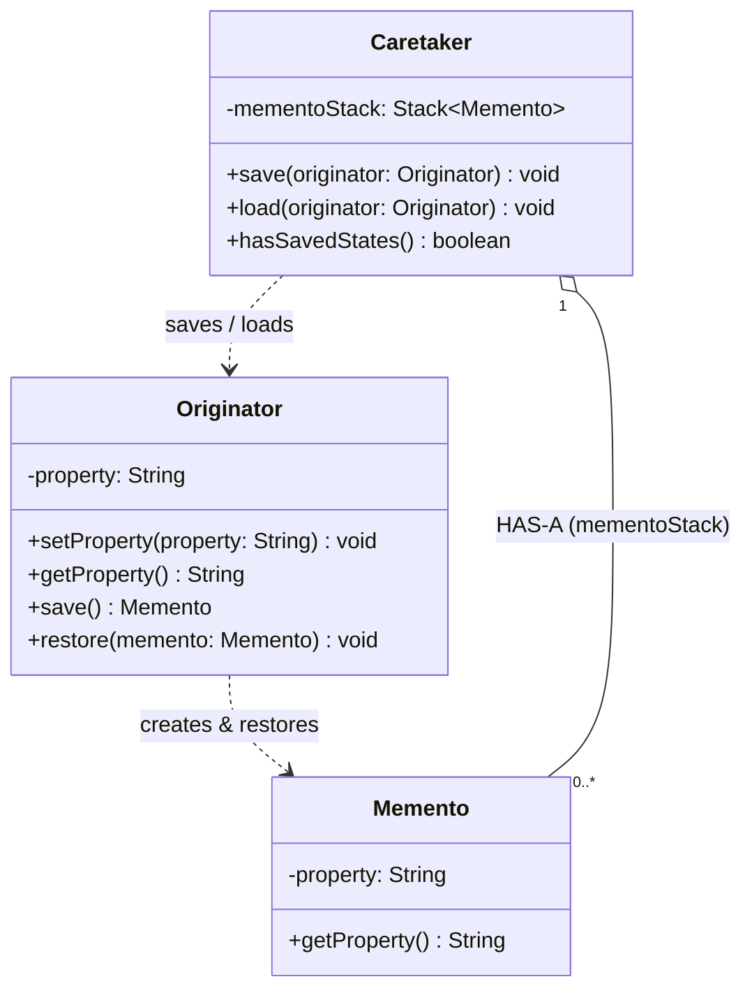

# Practical 09: Memento Design Pattern (File Restoring System)

This project implements the **Memento Design Pattern** in Java based on the **Practical 09** specification under the `lk.jiat.jms` and `com.lakruwan.memento` packages.

---

## 📌 Problem Overview & Pattern Definition

> **Memento Pattern** captures and externalizes an object's internal state so that it can be restored later, all without violating encapsulation.

In document processing, text editing, and file management systems:
- An object's state undergoes multiple modifications over time.
- If an accidental modification, data corruption, or unwanted edit happens, the application must be able to restore the object back to a previous valid state.
- **Without Memento Pattern**: Exposing internal file structures to external classes breaks encapsulation and leaks private implementation details.
- **With Memento Pattern**: The **Originator** creates an immutable snapshot (**Memento**) and delegates state restoration to it. The **Caretaker** maintains the history of snapshots (using a `Stack`) without ever inspecting or tampering with the internal file content.

---

## ❓ Practical Questions & Solutions

### Question 1: What are the three key components in Memento pattern?

1. **Originator (`Originator` / `FileDocument`)**:
   - The primary object whose state needs to be saved and restored.
   - It creates a **Memento** containing a snapshot of its current internal state (`save()` / `createSnapshot()`).
   - It restores its internal state when passed a **Memento** (`restore(memento)` / `restoreFromSnapshot()`).

2. **Memento (`Memento` / `FileSnapshot`)**:
   - A passive, immutable value object that stores the internal state of the Originator.
   - It protects against access by objects other than the Originator (ensuring strict encapsulation).
   - Only the Originator has the privilege to produce and extract its private state data.

3. **Caretaker (`Caretaker` / `FileHistoryManager`)**:
   - The entity responsible for tracking and safeguarding the history of Mementos (typically stored in a `Stack<Memento>`).
   - It triggers save requests (`save(originator)`) and load/restore requests (`load(originator)`).
   - **Crucially, the Caretaker never operates on, modifies, or inspects the contents of a Memento.**

---

### Question 2: Write a program to demonstrate File restoring process by implementing the Memento pattern.
The demonstration includes:
1. **Creating a file**: Initializing the file with an initial filename and content.
2. **Writing and saving contents to the file**: Modifying content through multiple revisions and pushing snapshots onto the Caretaker's Memento stack.
3. **Restoring it to last saved state**: Popping the most recent snapshot from the stack to revert changes (supporting multi-level undo).

---

## 🏛️ Class Diagram & Architecture



### Component Mapping

| Component | Class Name | Role | Responsibilities |
| :--- | :--- | :--- | :--- |
| **Originator** | `lk.jiat.jms.Originator` | File State Owner | Holds `-property` (file content), creates snapshots via `save()`, restores via `restore(Memento)`. |
| **Memento** | `lk.jiat.jms.Memento` | Immutable State Snapshot | Encapsulates the `-property` snapshot with read access via `+getProperty()`. |
| **Caretaker** | `lk.jiat.jms.Caretaker` | History Manager | Holds `-mementoStack: Stack`, coordinates `+save(originator)` and `+load(originator)`. |
| **Client Runner** | `lk.jiat.jms.Main` | Test Driver | Demonstrates file creation, incremental saves, corruption simulation, and step-by-step undo restoration. |
| **Extended GUI** | `com.lakruwan.memento.FileEditorUI` | Interactive UI | Java Swing text editor with live Memento stack visualizer, undo/redo buttons. |

---

## 💻 Source Code Implementation

### 1. `Memento.java`
```java
package lk.jiat.jms;

public class Memento {
    private final String property;

    public Memento(String property) {
        this.property = property;
    }

    public String getProperty() {
        return property;
    }
}
```

### 2. `Originator.java`
```java
package lk.jiat.jms;

public class Originator {
    private String property;

    public Originator() {}

    public Originator(String property) {
        this.property = property;
    }

    public void setProperty(String property) {
        this.property = property;
    }

    public String getProperty() {
        return property;
    }

    public Memento save() {
        return new Memento(this.property);
    }

    public void restore(Memento memento) {
        if (memento != null) {
            this.property = memento.getProperty();
        }
    }
}
```

### 3. `Caretaker.java`
```java
package lk.jiat.jms;

import java.util.Stack;

public class Caretaker {
    private final Stack<Memento> mementoStack = new Stack<>();

    public void save(Originator originator) {
        if (originator != null) {
            mementoStack.push(originator.save());
            System.out.println("[Caretaker] State saved to Memento stack. (Stack size: " + mementoStack.size() + ")");
        }
    }

    public void load(Originator originator) {
        if (originator != null && !mementoStack.isEmpty()) {
            Memento memento = mementoStack.pop();
            originator.restore(memento);
            System.out.println("[Caretaker] State restored from Memento. (Stack size: " + mementoStack.size() + ")");
        } else {
            System.out.println("[Caretaker] No saved state found in stack to restore!");
        }
    }
}
```

---

## 🚀 How to Run

### Option 1: Run Console Demonstration
```bash
# In Memento-Pattern-Application or OODP2-9
mvn compile exec:java -Dexec.mainClass="lk.jiat.jms.Main"
```

### Option 2: Run Interactive GUI Editor
```bash
mvn compile exec:java -Dexec.mainClass="com.lakruwan.memento.FileEditorUI"
```

### Option 3: Run Interactive Launcher
```bash
mvn compile exec:java
```

---

## 📋 Sample Console Execution Output

```text
===============================================================
      Practical 09: File Restoring Process (Memento Pattern)    
===============================================================

[1] Creating a file...
--> Initial File State: Assignment_01.txt | Version 1.0: Title and Introduction written.

[2] Writing and saving contents to the File...

--- Saving Initial State (State 1) ---
[Caretaker] Successfully saved state to Memento stack. (Current stack size: 1)

--- Writing update: Added Section 1 (State 2) ---
--> Current File State: Assignment_01.txt | Version 1.1: Section 1 - Memento Pattern Overview added.
[Caretaker] Successfully saved state to Memento stack. (Current stack size: 2)

--- Writing update: Added Section 2 (State 3) ---
--> Current File State: Assignment_01.txt | Version 1.2: Section 2 - Originator, Memento, Caretaker implemented.
[Caretaker] Successfully saved state to Memento stack. (Current stack size: 3)

--- Unwanted Modification / Accidental Overwrite! ---
--> Current Corrupted State: Assignment_01.txt | [CORRUPTED: Entire document text mistakenly erased!]

[3] Restoring File to last saved state...
[Caretaker] Successfully restored state from Memento. (Remaining stack size: 2)
--> Restored File State: Assignment_01.txt | Version 1.2: Section 2 - Originator, Memento, Caretaker implemented.

--- Restoring File to previous state once more (Undo) ---
[Caretaker] Successfully restored state from Memento. (Remaining stack size: 1)
--> Restored File State: Assignment_01.txt | Version 1.1: Section 1 - Memento Pattern Overview added.

--- Restoring File back to Initial State ---
[Caretaker] Successfully restored state from Memento. (Remaining stack size: 0)
--> Restored File State: Assignment_01.txt | Version 1.0: Title and Introduction written.

--- Attempting to restore when history is empty ---
[Caretaker] Error: No saved states in stack to restore!

===============================================================
             Memento Pattern Execution Completed               
===============================================================
```

