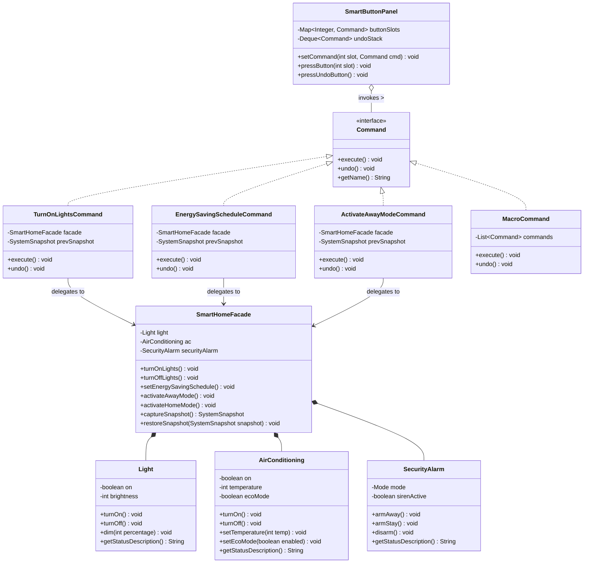

# Smart Home Automation System (Command & Facade Patterns)

## 📌 Problem Scenario
> **"A smart home system that controls lights, air conditioning, and security alarms. A user can press a button to turn on the lights, create an energy-saving schedule, or activate away mode."**

---

## 🏗️ Design Patterns Applied

### 1. Facade Design Pattern (Structural)
- **Role**: Coordinates the complex multi-device subsystems (`Light`, `AirConditioning`, `SecurityAlarm`) behind a unified, high-level interface.
- **Class**: `SmartHomeFacade`
- **Key Methods**:
  - `turnOnLights()`: Activates the primary illumination system.
  - `setEnergySavingSchedule()`: Concurrently dims lights to 30%, activates AC Eco mode at 26°C, and arms perimeter security in Stay mode.
  - `activateAwayMode()`: Turns off all lights, sets AC to standby/off, and arms the security alarm in Away mode (motion sensors active).
  - `activateHomeMode()`: Turns on lights, restores comfortable 22°C AC, and disarms security alarms.

### 2. Command Design Pattern (Behavioral)
- **Role**: Encapsulates user actions (button presses) as first-class objects. Decouples the button invoker from the receivers and facade, and provides undo capability.
- **Interface**: `Command` (`execute()`, `undo()`, `getName()`)
- **Concrete Commands**:
  - `TurnOnLightsCommand`: Encapsulates turning on the lighting system.
  - `EnergySavingScheduleCommand`: Encapsulates the energy-saving profile.
  - `ActivateAwayModeCommand`: Encapsulates arming away mode and shutting down active appliances.
  - `ActivateHomeModeCommand`: Encapsulates returning home.
  - `TurnOffLightsCommand`: Encapsulates turning off lights.
  - `MacroCommand`: Demonstrates Composite / Macro Command pattern by executing a batch of commands sequentially and undoing them in reverse order.
- **Invoker**: `SmartButtonPanel` / `RemoteControl`
  - Maintains button slots and a LIFO history stack (`Deque<Command>`) for multi-level undo.

---

## 📊 UML Class Diagram



---

## 📂 Project Directory Structure

```
SmartHome-Command-Application/
├── pom.xml
├── README.md
└── src/
    ├── main/
    │   └── java/
    │       ├── com/lakruwan/smarthome/
    │       │   ├── Launcher.java                 # GUI application launcher
    │       │   ├── command/                      # Command Pattern
    │       │   │   ├── Command.java
    │       │   │   ├── TurnOnLightsCommand.java
    │       │   │   ├── TurnOffLightsCommand.java
    │       │   │   ├── EnergySavingScheduleCommand.java
    │       │   │   ├── ActivateAwayModeCommand.java
    │       │   │   ├── ActivateHomeModeCommand.java
    │       │   │   └── MacroCommand.java
    │       │   ├── facade/                       # Facade Pattern
    │       │   │   ├── SmartHomeFacade.java
    │       │   │   └── SmartHomeListener.java
    │       │   ├── invoker/                      # Command Invoker
    │       │   │   └── SmartButtonPanel.java
    │       │   ├── subsystem/                    # Subsystem Devices
    │       │   │   ├── Light.java
    │       │   │   ├── AirConditioning.java
    │       │   │   └── SecurityAlarm.java
    │       │   └── ui/                           # Modern Swing Desktop GUI
    │       │       └── SmartHomeUI.java
    │       └── lk/jiat/jms/
    │           └── Main.java                     # Standalone CLI console practical demo
    └── test/
        └── java/
            └── com/lakruwan/smarthome/
                ├── SmartHomeTest.java            # JUnit 5 test suite
                └── SmartHomeTestRunner.java      # Standalone test runner (0 dependencies)
```

---

## 🚀 How to Run

### 1. Run the Standalone Console Practical Demo
```powershell
javac -d target/classes src/main/java/lk/jiat/jms/Main.java
java -cp target/classes lk.jiat.jms.Main
```

### 2. Run the Modern Desktop GUI
```powershell
$sources = Get-ChildItem -Recurse -Filter *.java src/main/java | Select-Object -ExpandProperty FullName
javac -d target/classes $sources
java -cp target/classes com.lakruwan.smarthome.Launcher
```

### 3. Run Automated Tests
```powershell
javac -cp "target/classes" -d "target/test-classes" src/test/java/com/lakruwan/smarthome/SmartHomeTestRunner.java
java -cp "target/classes;target/test-classes" com.lakruwan.smarthome.SmartHomeTestRunner
```
